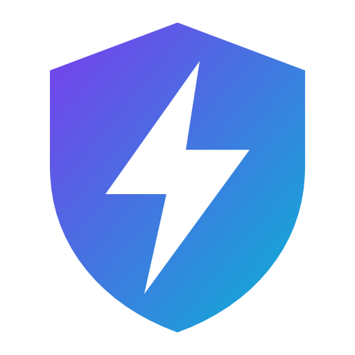
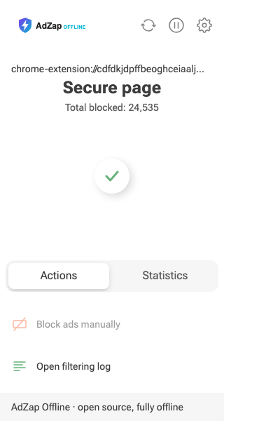
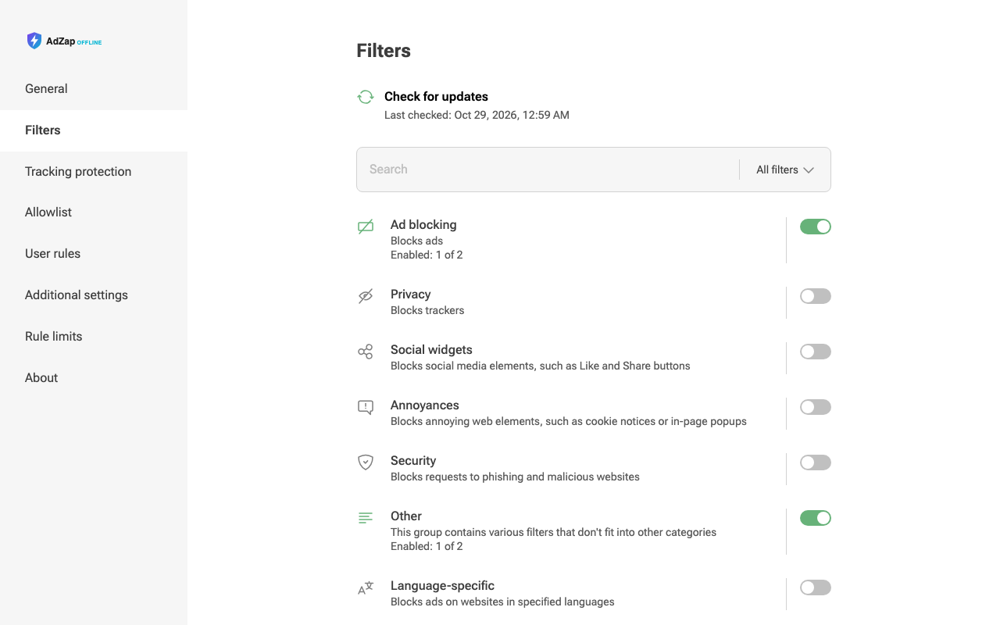

  

<h1 align="center">AdZap Offline</h1>

  <b>An ad and tracker blocker for Chrome that never phones home.</b> 
  No telemetry. No update pings. No accounts. It just blocks stuff — quietly, on your computer.

---

## Why this exists

Most ad blockers are great at blocking other people's tracking — but a lot of them still talk to their own servers in the background. Update checks with a unique ID, usage stats, "thank you" pages that open on install, and so on.

AdZap Offline is a version of an ad blocker that's been locked down so it **can't** do any of that. Chrome itself is told to block every connection the extension tries to make to the internet. I tested this by watching all network traffic while browsing — the extension made zero connections out.

## What it does

- **Blocks ads, pop-ups and trackers** on the sites you visit — the blocking lists are built in.
- **Works fully offline.** Nothing about your browsing ever leaves your computer.
- **No telemetry, no stats, no "anonymous usage data"** — those features are removed, not just switched off.
- **No accounts, no sign-up, no tracking ID.**
- **Block anything manually** — click "Block ads manually" in the menu and point at the thing you want gone.
- **Allowlist** — turn blocking off for sites you trust (or sites that break).
- **Pause with one click** if a page isn't working right.
- **Filtering log** — see exactly what was blocked on a page.
- **Your own rules** for power users, plus import/export of settings.
- **Light and dark mode**, and it's translated into 50+ languages.

  
  &nbsp;&nbsp;
  

## How to install (about 2 minutes)

AdZap Offline isn't on the Chrome Web Store, so you install it by hand. It's easier than it sounds.

1. **Download it.** Go to the [Releases page](https://github.com/arush361/adzap-offline/releases/latest) and download the file called `AdZap-Offline-v1.0.0.zip`.
2. **Unzip it.** Double-click the zip. You'll get a folder called `AdZap-Offline`.
3. **Move that folder somewhere it can stay forever** — like your Documents folder. ⚠️ If you move or delete this folder later, the extension stops working.
4. **Open Chrome's extensions page.** Type `chrome://extensions` into the address bar and press Enter.
5. **Turn on "Developer mode"** using the switch in the top-right corner.
6. **Click "Load unpacked"** (top-left) and pick the `AdZap-Offline` folder from step 3. Pick the folder that has a file called `manifest.json` directly inside it — on Windows, unzipping sometimes puts it one folder deeper. If Chrome says the manifest is missing, open the folder and pick the inner `AdZap-Offline` one.
7. **Pin it** so it's easy to find: click the puzzle-piece icon next to the address bar, then the pin next to AdZap Offline.

That's it. You'll see the purple lightning-bolt shield in your toolbar. Click it any time to see what's been blocked or to pause it.

### Updating to a new version

There's no automatic updating — that's on purpose, since updates would mean contacting a server. To update:

1. Open AdZap settings → **General** → **Export settings** (keeps your allowlist and rules).
2. On `chrome://extensions`, click **Remove** on the old AdZap Offline.
3. Install the new version using the steps above, then **Import settings**.

### Uninstalling

Go to `chrome://extensions`, find AdZap Offline and click **Remove**. Then delete the folder. Done — no account to close, no data left on a server anywhere.

## Limitations — please read

I'd rather be upfront about these:

- **Chrome only (for now).** Built and tested on Google Chrome. It'll probably work on other Chromium browsers like Edge and Brave, but I haven't tested them. No Firefox, Safari or phones.
- **The blocking lists don't update themselves.** They're frozen at the date the version was built (this one: late August 2026). New kinds of ads may slip through over time until you install a newer version. That's the trade-off for being fully offline.
- **No automatic security fixes.** Because it never checks for updates, you won't get fixes unless you install a new version yourself. Watch this repo (the "Watch" button at the top) if you want to hear about new releases.
- **"Developer mode" has to stay on.** Chrome may now and then remind you that you have developer-mode extensions installed. That's normal for anything installed this way.
- **Work computers may block it.** If your company manages your browser, "Developer mode" or "Load unpacked" might be greyed out. Check with your IT team before installing on a work machine.
- **Some sites may act up.** Any ad blocker can occasionally break a page (logins, video players, checkout pages). Hit the pause button or add the site to your allowlist.
- **Subscribing to extra filter lists from a web address doesn't work** — that would need an internet connection, which this extension deliberately doesn't have.
- **It's an extension, not a system-wide blocker.** It only protects Chrome, not other apps.
- **No warranty.** It's free, open source and provided as-is. I'm one person maintaining it.

## Is it really offline? How do I know?

You don't have to take my word for it:

- The extension's manifest includes a rule (`connect-src 'self'`) that tells Chrome to block every outgoing connection the extension tries to make. Chrome enforces this, not the extension.
- The code that sent update checks, usage stats and filter statistics has been removed.
- I loaded it in a fresh browser, deliberately switched **on** every data-sharing setting, browsed a few news sites and recorded all network traffic. The extension made zero connections of its own — while still blocking requests to about 20 ad and tracking services, including Google's ad network (DoubleClick), Amazon ads and The Trade Desk.

If you're technical and want to check for yourself, see [docs/BUILDING.md](docs/BUILDING.md) to build it from source.

## Found a problem?

[Open an issue](https://github.com/arush361/adzap-offline/issues) and tell me what happened and on which website. Screenshots help.

## License and credits

AdZap Offline is free and open-source software under the [GNU GPL v3](LICENSE). It's a modified version of an existing open-source GPL-3.0 project — see [NOTICE](NOTICE) for the original copyright, what was changed and the third-party licenses.
